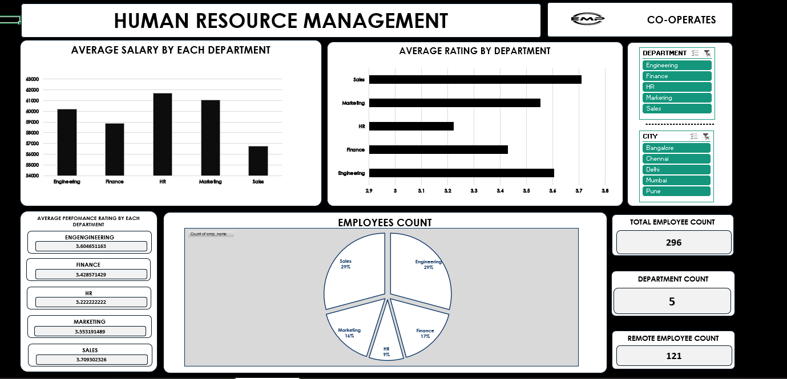

# Employee-Data-Analysis
n EDA project analyzing workforce distribution, salary trends, experience, and performance ratings across India. Translates raw HR data into strategic insights to optimize talent acquisition, compensation management, and operational decision-making across diverse departments.

